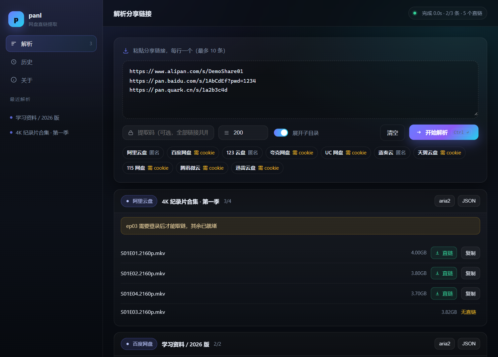
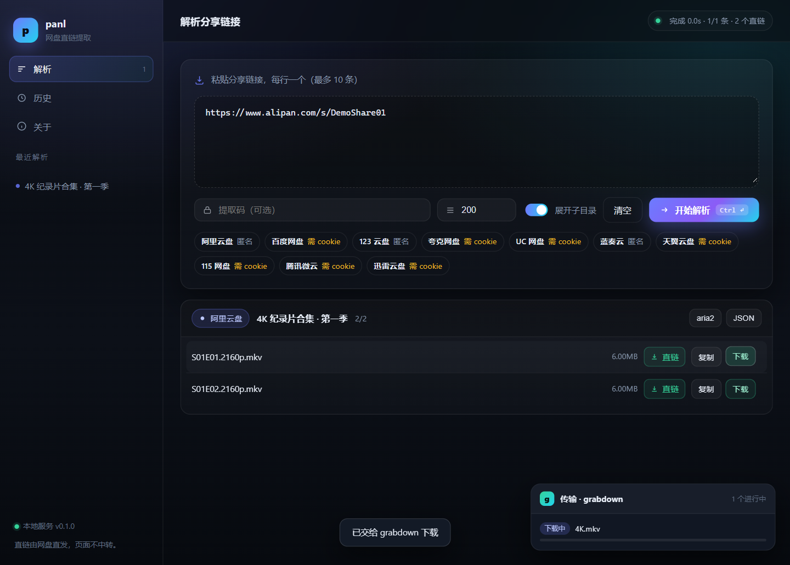

# panl — 多网盘分享直链提取器

一个本地 CLI：丢进去一个分享链接，吐回**能直接下载的直链 + 必须携带的请求头**，顺带支持
直接下载、导出 aria2/curl/wget 脚本、JSON 结构化输出。

支持：阿里云盘 · 百度网盘 · 123 云盘 · 夸克网盘 · UC 网盘 · 蓝奏云 · 天翼云盘 · 115 网盘 ·
腾讯微云（实验）· 迅雷云盘（实验）

```
python -m panl resolve "https://www.alipan.com/s/xxxx" --export aria2
```

> 配套项目：[**grabdown**](https://github.com/sunday-lil/grabdown) —— IDM 式多线程下载器 + 浏览器扩展。
> panl 负责「链接 → 直链」，grabdown 负责「直链 → 文件」；GUI 里点「下载」就是交给它。

> **TL;DR (EN)** — A local, no-backend extractor for 10 Chinese netdisk services:
> paste a share link, get a **direct download URL plus the exact headers it needs**
> (Referer / UA / Cookie). Ships a desktop GUI (Chromium `--app` window), a CLI, a small
> web UI, share-transfer (`transfer`), and an overridable endpoint layer so a vendor
> domain change never needs a code change. 36 offline tests, zero service dependency.
> Supports: aliyun, baidu, 123pan, quark, uc, lanzou, 189 (tianyi), 115, weiyun, xunlei.

---

## 0. 桌面版（推荐）

```bash
python -m panl gui            # 起服务 + 打开独立窗口
python -m panl gui --size 1400,900 --port 9000
```
双击 `GUI.cmd` 也可以（用 pythonw 起，无控制台）。



- 窗口是 Chromium 的 `--app` 模式：**没有地址栏、没有标签栏**，独立任务栏图标，独立 user-data-dir；
- 界面单文件（`panl/ui_app.py`）：深色玻璃拟态、左侧导航、拖拽粘贴、骨架屏、结果卡片、历史记录（localStorage）、`Ctrl+Enter` 解析；
- 关掉窗口 = 服务退出，不留后台进程。

## 0.1 网页版（浏览器里粘贴链接）

```bash
python -m panl web            # http://127.0.0.1:8765
python -m panl web --port 9000 --open
```

- 单文件页面 + 标准库 `http.server`，无前端构建、无外网 CDN，离线可用；
- 默认只绑 `127.0.0.1`（本工具会带 cookie 请求网盘，别随手开公网）；
- 页面能力：批量粘贴（≤10 条）→ 提取码 → 展开子目录 → 结果卡片（`resolved/total`、无直链原因）
  → 每文件「复制 curl」、每条结果「导出 aria2 / JSON」；
- 接口就三个：`GET /api/providers`、`POST /api/resolve`、`POST /api/export`，脚本也能直接调：

```bash
curl -s -X POST http://127.0.0.1:8765/api/resolve \
  -H 'Content-Type: application/json' \
  -d '{"urls":["https://www.alipan.com/s/xxxx"],"pwd":"","recursive":true}'
```

> 注意：秒哒（appmiaoda.com）上那种「网盘直链解析工具」页面，绝大多数只是 UI 外壳 ——
> 点下去生成的是 `https://download.example.com/<platform>/<时间戳>/file.zip` 加一个
> `Math.random()` 的文件大小，没有后端、没有真实解析。本项目的页面调的是同一套真实解析器。

## 0.2 一键下载（接 grabdown）



每个文件行多了「下载」按钮：点它，直链（连同必带的 Referer / Cookie）丢给本地
`grabdown agent`，由那边的分段引擎下载到本地，进度实时出现在右下角「传输」面板。

```bash
# 一个终端起下载器
cd ../grabdown && python -m grabdown agent          # 127.0.0.1:8899

# 另一个终端起 GUI（默认就找 8899，可用 --agent 改）
cd ../panl && python -m panl gui
cd ../panl && python -m panl gui --agent http://127.0.0.1:9900
```

实现要点：

- `panl/grab.py` 只是 agent 的薄客户端，**不 import 另一个项目**；
- 有活跃任务时 0.5s 轮询、空闲 3s，变化通过 **SSE**（`/api/grab/stream`）推给页面；
- agent 没起时按钮照样在，点了会提示 `python -m grabdown agent`，不会静默失败；
- 提交时会把该文件的 `headers` 带过去（Referer / UA / Cookie），所以百度的 netdisk UA、
  阿里的 Referer 都能原样生效。

## 0.3 转存 / 搬运（工具站真正缺的那一半）

```bash
# 把别人的分享转存进自己网盘（会占你自己的配额）
python -m panl transfer "https://pan.baidu.com/s/1abc" -p 12ab --to /我的资源

# 转存后顺手生成你自己的分享链接
python -m panl transfer "URL" -p 12ab --to /我的资源 --share --period 7
```

流程与接口：

```
解析分享（shareid / uk / fsid） → POST /share/transfer（fsidlist + sekey）
        → GET /api/list 校验落地 → POST /share/create 生成 /s/xxx
```

需要 `BDUSS`（`panl cookie set baidu BDUSS=...`），`bdstoken` 自动从 `/disk/home` 抓。
目前只实现了百度；阿里/夸克/115 的转存要 access_token / csrf，接口形状不同，
`panl/transfer.py` 里留了位置。

> `--share` 会生成**新的分享链接**，等于把这些文件再传播一次。自己存可以，转出去自己掂量。


## 0.4 百度直链为什么老 403

两个硬条件，缺一个就下不动：

1. **UA 必须是 `netdisk` 前缀**。`panl` 默认用 BaiduPCS-Go 里那串
   `netdisk;P2SP;3.0.0.8;netdisk;11.12.3;ANG-AN00;android-android;10.0;JSbridge4.4.0;jointBridge;1.1.0;`
   （客户端二进制里自己写着「访问下载链接需把 UA 设置为 …」）。个别文件要换串：

   ```bash
   python -m panl resolve "URL" -p 1234 --user-agent "netdisk;P2SP;2.2.2;PC;PC-Windows;10.0.18363;WindowsBaiduYunGuanJia;1"
   ```

2. **带 `Referer: https://pan.baidu.com/` 与自己账号的 cookie**（BDUSS/BDCLND）。`--export aria2` 已全部拼好。

进阶通道：`method=locatedownload` 需要签名 `time/rand/devuid/cuid`，算法已复刻在
[`panl/sign.py`](panl/sign.py)（源自 BaiduPCS-Go v4.0.2 的 `netdisksign`）：

```python
from panl.sign import dev_uid, locate_download_query
q = locate_download_query(uid=你的uid, bduss="BDUSS 值")   # time=..&rand=..&devuid=..&cuid=..
```

配合 `transfer` 转存到自己网盘后取链，可绕开分享 dlink 的限制（下一步接上）。

## 0.5 怎么一眼认出「假工具站」

| 站点类型 | 看什么 | 判断 |
|---|---|---|
| 秒哒/appmiaoda 那类 | JS 里 `download.example.com`、`Math.random()`、没有 `fetch(` | UI 壳，点了解析出的是假链接 |
| pandown 那类 | 只有 `api.php?action=get_config / verify_passcode / track_event` 三个接口，`verify_passcode` 就是卡密闸；`get_config` 的文案是「不限速通道需凭加速口令」 | 引流/卡密页，工具本体不存在 |
| 真工具 | 有对应网盘的解析接口（本文档第 1 节那些域名）+ 直链带 Referer/UA | 能用 |

判别口诀：**F12 → Network → 点一次「解析」，看有没有发出去一个真的网盘 API 请求**。
没有，就是壳。

---

## 0.6 端点可覆盖（换域名不用改代码）

抄的是 panlinker / baidujiexi_app 那套「上游地址不进代码」的思路，但**默认值留在本地**，
不请求任何第三方配置服务器：

```bash
python -m panl endpoints show                    # 看当前端点（* 表示被覆盖）
python -m panl endpoints set 'aliyun.api_hosts=["https://api.aliyundrive.com"]'
python -m panl endpoints set quark.host=drive-pc.quark.cn
python -m panl endpoints set 'lanzou.domains=["lanzoue.com","lanzoux.com","新镜像.test"]'
python -m panl endpoints reset                   # 回到内置默认
```

优先级：`PANL_ENDPOINTS_JSON`（环境变量，JSON） > `~/.panl/endpoints.json` > 内置默认。
已接入：aliyun(hosts/referer)、quark/uc(host/referer)、123pan、lanzou(域名表)、189、115、baidu(UA)。

研究资料（对两个开源实现的架构分析）不随仓库发布，仅本地保留。

---

## 1. 支持矩阵

| 网盘 | 匿名可取直链 | 需要 cookie | 状态 | 关键接口 |
|---|---|---|---|---|
| 阿里云盘 aliyun | ✅ | 限流时 | stable | `share_link/get_share_by_anonymous` → `file/list` → `get_share_link_download_url` |
| 123 云盘 123pan | ✅ | 否 | stable | `share/info` → `share/get` → `share/download/info` |
| 蓝奏云 lanzou | ✅ | 否 | stable | 分享页 → `/fn` → `ajaxm.php?file=` |
| 百度网盘 baidu | 部分（小文件） | ✅ BDUSS | stable | `/share/verify` → `/share/list` → 条目 `dlink` |
| 夸克 quark | 列表可以、下载要登录 | ✅ `__puus` | stable | `sharepage/token` → `detail` → `download` |
| UC 网盘 uc | 同上（同构接口） | ✅ `__puus` | stable | 同上，域名换 `drive-pc.uc.cn` |
| 天翼云盘 189 | 列表可以、下载要登录 | ✅ `COOKIE_LOGIN_USER` | stable | `getShareInfoByCode` → `listShareDir` → `getShareDownloadUrl` |
| 115 网盘 115 | 否 | ✅ `UID/CID/SEID/KID` | stable | `share/snap` → `share/downurl` |
| 腾讯微云 weiyun | 否 | ✅ `uid/skey` | experimental | 多套候选接口，命中哪套用哪套 |
| 迅雷云盘 xunlei | 否 | ✅ + 可能人机校验 | experimental | `drive/v1/share` → `web_content_link` |

> 「experimental」= 厂商前端接口不公开且改版频繁。失败时 panl 会抛出 `[parse]` 并附上真实响应片段，
> 按片段在对应 provider 里加一条候选正则即可，不用重写。

---

## 2. 安装

零依赖（只要 `requests`，网上盘都不需要）：

```bash
pip install requests
git clone <this-repo> && cd <repo>
python -m panl doctor      # 自检：python / requests / cookie / 网络
python -m panl providers   # 看支持列表
```

Windows 上可直接用 `panl.cmd`（见仓库根），或把 `python -m panl` 换成任意别名。

---

## 3. 用法

### 3.1 取直链

```bash
# 阿里云盘：匿名直接出链
python -m panl resolve "https://www.alipan.com/s/AbCdEf123"

# 百度：带提取码
python -m panl resolve "https://pan.baidu.com/s/1AbCdEf?pwd=1234" -p 1234

# 夸克：列表 + 直链
python -m panl resolve "https://pan.quark.cn/s/1a2b3c4d"

# 一次多个
python -m panl resolve "URL1" "URL2" "URL3" --json
```

### 3.2 导出给下载器

```bash
python -m panl resolve "URL" --export aria2 --out dl.sh   # aria2c -x16 -s16 --header=...
python -m panl resolve "URL" --export curl                # 打印到 stdout
python -m panl resolve "URL" --export wget --out wget.sh
python -m panl resolve "URL" --export txt                 # 名字 \t 大小 \t 直链
python -m panl resolve "URL" --json                       # 给脚本吃
```

**关键**：直链几乎都要求 `Referer` / `User-Agent`（百度还要求 `Cookie`）。
`--export` 已经把每个文件的必需头拼进命令行；手抄直链到浏览器多半 403，就是这个原因。

### 3.3 直接下载

```bash
python -m panl resolve "URL" --download --out-dir ./dl --overwrite
```

### 3.4 cookie 管理（本地文件，权限 600）

```bash
python -m panl cookie set baidu  BDUSS=xxxx STOKEN=yyyy
python -m panl cookie set quark  __puus=xxxx
python -m panl cookie set 115    UID=1 CID=2 SEID=3 KID=4
python -m panl cookie set 189    COOKIE_LOGIN_USER=xxxx
python -m panl cookie set xunlei _PUID=xxx XLA_CI=xxx
python -m panl cookie show baidu
python -m panl cookie clear quark
python -m panl cookie path
```

cookie 落盘在 `~/.panl/cookies.json`（可用 `--cookie-file` 或 `PANL_COOKIES` 改）。

**怎么拿**：浏览器登录对应网盘 → F12 → Network → 任意 XHR 请求 → 复制 Request Headers 里的
`cookie:`，挑出上表那几个字段填进去即可。只需要 cookie 字段，不需要账号密码。

---

## 4. 输出长什么样

```
== aliyun · 我的剧集  (3 files) ==
  OK     1.02GB  ep01.mkv
  OK   980.11MB  ep02.mkv
  --          ?  ep03.mkv
   ! 1 个文件没有直链（需要登录/转存/风控拦截）: ep03.mkv
```

```json
{
  "provider": "aliyun",
  "share_id": "AbCdEf123",
  "title": "我的剧集",
  "file_count": 3,
  "resolved_count": 2,
  "files": [
    {
      "name": "ep01.mkv",
      "size": 1094713344,
      "is_dir": false,
      "path": "/第一季",
      "download_url": "https://cn-beijing-data.aliyundrive.net/...",
      "headers": { "Referer": "https://www.aliyundrive.com/", "User-Agent": "Mozilla/..." }
    },
    { "name": "ep03.mkv", "download_url": null, "...": "..." }
  ],
  "dirs": []
}
```

拿不到直链的文件**也照样列出**（`download_url: null`），这样能一眼分辨是缺 cookie 还是被风控，
比静默跳过有用。

---

## 5. 退出码

| 码 | 含义 | 常见处置 |
|---|---|---|
| 0 | 成功（可能有部分文件无直链，看 `note` / `resolved_count`） | — |
| 2 | 用法错误 | `-h` |
| 3 | 网络/限流 | 降速、换网络、等几分钟 |
| 4 | 需要登录 cookie | `panl cookie set <provider> ...` |
| 5 | 提取码错误/缺失 | `-p <pwd>` |
| 6 | 需要人机校验 | `--header "x-captcha-token:..."` |
| 7 | 分享不存在/已取消 | 检查链接 |
| 8 | 不支持的链接 / 页面结构变了 | 见 `[parse]` 附带的响应片段 |

---

## 6. 失败原因对照

| 现象 | 原因 | 处置 |
|---|---|---|
| 列表有、直链全 `null` | 未登录 / 需转存 | 配 cookie；百度可加 `--transfer`（会占你网盘配额） |
| 直链 403 | 缺 Referer/UA/Cookie | 用 `--export aria2` 的现成命令，别手抄 |
| 直链下载到一半 403 | 直链过期（阿里 15 分钟，115 更短） | 重新解析 |
| `[auth] need_login` | 夸克/UC 的下载接口要登录态 | 配 `__puus` |
| `[captcha]` | 迅雷要人机校验 | 过检后带 `x-captcha-token` |
| `[parse] 找不到 /fn` | 蓝奏前端改版 | 按 `detail` 里的页面加一条候选正则 |
| 百度 `errno=-7` | 链接出错/失效 | 换链接 |

---

## 7. 加一个新网盘（5 步）

```python
# panl/providers/mydrive.py
from .base import Ctx, Provider
from ..models import Entry, Share

class MyDriveProvider(Provider):
    name = "mydrive"
    label = "我的网盘"
    needs_cookie = False
    cookie_hint = "匿名即可"

    def match(self, url): return "mydrive.com/s/" in url

    def resolve(self, url, pwd, ctx: Ctx) -> Share:
        r = ctx.session.get("https://api.mydrive.com/share/info",
                            provider=self.name, params={"id": url.rsplit("/", 1)[-1]})
        data = self.need_json(r, "share/info")
        return Share(provider=self.name, share_id="x", title=data["title"],
                     entries=[Entry(name=f["name"], size=f["size"], download_url=f["url"])])
```

然后把类加进 `panl/providers/__init__.py` 的 `ALL`，在 `panl/tests/test_flows.py` 里照抄一个
`TestXxx` 用 `Route(...)` 回放响应，`python -m unittest discover -s panl/tests -t .` 通过即可。

---

## 8. 频率与礼貌

- 同一网盘两次请求最小间隔 `--delay 0.35`（可调大），**默认串行、不并发**；
- 429/5xx 自动按 `Retry-After` 或指数退避重试，默认 2 次；
- 单次最多列 `--max 500` 个条目，避免一次扫穿整个分享。

## 9. 边界

- 只处理**公开分享链接**；提取码只接受用户自己输入的，不做暴力猜测。
- 不绕过会员/付费/风控；遇到 `[auth]` / `[captcha]` 就如实报出来，让你自己决定要不要配 cookie。
- 不缓存、不中转、不搬运文件内容；直链由网盘服务器直接发给你。
- `--transfer` 是官方转存行为，会写入你自己的网盘并占用配额，默认关闭。

## 10. 已知限制

- 阿里云盘直链 15 分钟过期；115 更短；导出脚本请尽快执行。
- 蓝奏域名有 20+ 个镜像，`panl` 已内置常用域；新镜像出现时在 `lanzou.py` 的 `DOMAINS` 里加一行。
- 微云/迅雷标 `experimental`：接口不公开，改版后可能需要按响应片段补一条候选。
- 百度大文件（>4G 或非会员限速）通常必须先转存再取链。

## 11. 目录

```
panl/
├── cli.py            # 命令行入口：resolve / cookie / providers / doctor
├── net.py            # 传输层：provider 级 cookie、限速、重试、响应封装
├── models.py         # Entry / Share
├── export.py         # aria2 / curl / wget / txt / json
├── errors.py         # 统一异常 + 退出码
├── providers/
│   ├── base.py       # Provider / Ctx
│   ├── aliyun.py baidu.py pan123.py quark.py lanzou.py tianyi.py
│   ├── pan115.py weiyun.py xunlei.py
└── tests/test_flows.py   # 19 个离线流程用例（FakeTransport 回放真实响应）
```

跑测试：

```bash
python -m unittest discover -s panl/tests -t . -v
```
